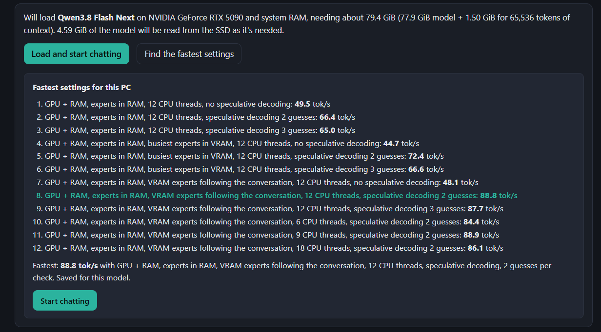
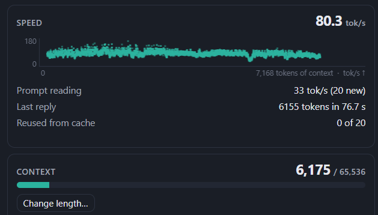
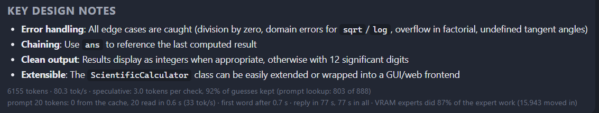
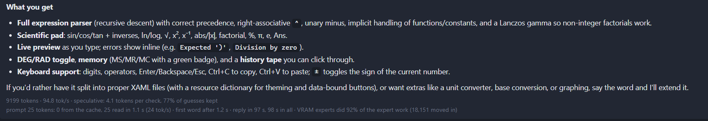
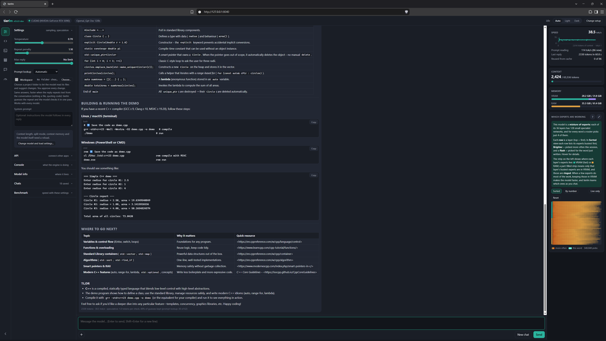
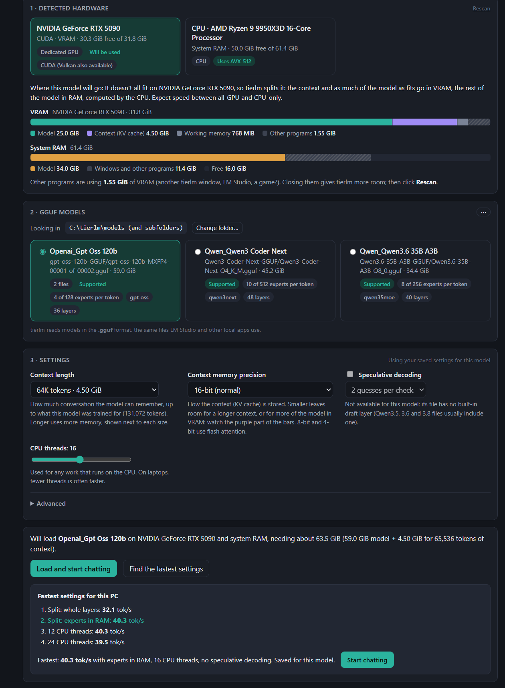

# tierlm

**A performance-first local LLM engine: it puts every part of a model in the preferred memory location. Big
models run as fast as your PC allows, and your RAM, not your GPU, sets how big you can go.**

tierlm is written from scratch in C++ by **Claude** (Anthropic's AI), with **Chad Jameson (EHTi)** directing
the project, making the design calls, and testing and debugging it on real hardware. It uses
[ggml](https://github.com/ggml-org/ggml)'s math kernels, with a few small changes that are all listed and explained
in [docs/GGML_CHANGES.md](docs/GGML_CHANGES.md); the tokenizers, model graphs, KV cache, memory planner, vision
encoder, server and web page are all tierlm's own. It does not use llama.cpp.

It runs **Llama 2/3, Mistral, Mixtral, Qwen2/2.5, Qwen3, Qwen3 MoE, Qwen3.5/3.6/3.8 dense and MoE, Qwen3-Next,
gpt-oss and OLMoE** on the CPU, on any GPU with Vulkan (Intel, AMD, NVIDIA), or on NVIDIA with CUDA, on **Windows**
(unzip and run) and **Linux** (build from source). A web page lets you pick a model and chat; an OpenAI-compatible API
serves your other apps.

### New in 0.8.7: the same PC, the same models, much faster

| Measured in the app's chat | before | **0.8.7** |
|---|---|---|
| Qwen3.8 Flash-Next Q4_K_M, the 120 GB model, on one RTX 5090 (32 GB): a 6,155-token C++ program | 40.2 tok/s (0.8.3) | **80.3 tok/s** (88.8 in Find the fastest settings) |
| Qwen3.8 Flash-Next UD-IQ3_XXS (4 files, 77.9 GiB) on the same card: a 9,199-token C# program | 54-76 tok/s (0.8.5) | **94.8 tok/s** |
| gpt-oss-120b MXFP4 (59 GiB) on the same card: a 5,218-token C program | 38.5 tok/s (0.7.0, 64K context) | **44.1 tok/s** (32K context; 47.5 in Find the fastest settings) |
| Qwen3.6-35B-A3B (17 GB) on an 8 GB laptop RTX 3070: code, contract law, science and a story | 35.6 tok/s (0.8.3) | **44.0 tok/s** |
| The wait for the first word of a short message, experts in RAM (RTX 5090) | 1.4 s (0.8.6) | **0.3 s** |
| A coding agent's 2,474-token instructions at the start of every session (RTX 5090) | 7.5 s (0.8.6) | **0.2 s**, loaded from the SSD, also after a restart |

0.8.7 keeps its guessing work ready, lets the experts in VRAM follow the conversation, stops copying experts to
the GPU to read a short prompt, and saves a conversation's opening on the SSD. RTX 5090 (32 GB), Ryzen 9 9950X3D,
64 GB DDR5-6000, NVMe; the laptop is an RTX 3070 Laptop (8 GB), Ryzen 9 5900HX, 32 GB. Every setting is in the
[spotlight below](#spotlight-qwen38-flash-next-on-one-rtx-5090) and on [tierlm.com/performance](https://tierlm.com/performance/#v087).

### At a glance

| | |
|---|---|
| **Guesses ahead** | Qwen3.8 Flash-Next UD-IQ3_XXS (77.9 GiB) at **94.8 tok/s** on one RTX 5090 with its own draft file, writing a 9,199-token program ([details below](#spotlight-qwen38-flash-next-on-one-rtx-5090)) |
| **Bigger than your RAM** | Qwen3.8 Flash-Next (120 GB) at **80.3 tok/s** on one RTX 5090 (32 GB) with 64 GB of RAM: the SSD tier reads the rarely used parts from an NVMe drive as each word needs them |
| **Bigger than your GPU** | gpt-oss-120b (59 GB) at **44.1 tok/s** on one RTX 5090 (32 GB); Qwen3-Coder-Next 80B at **63.8 tok/s** on the same card; Qwen3.6-35B-A3B (17 GB) at **44 tok/s** on an 8 GB laptop RTX 3070 |
| **Reads images** | screenshots, photos, scanned and handwritten pages, with Qwen3.5 / 3.6: a 4K screenshot read in **0.65 s** on an RTX 5090, a full-screen one in **2.7 s** on the laptop |
| **Works on your projects** | the model lists, reads and searches a folder and proposes changes you see side by side and approve, one by one; each chat keeps its own folder |
| **Never hits a wall** | chats are saved as readable files; when a conversation fills the context, the oldest messages are archived and looked back at when they matter |
| **Serves your apps** | OpenAI-compatible API with tool calling and images, an embedding model alongside, a queue, and several replies at once: **4 at once, 364 tok/s in all** on one RTX 5090 |
| **Tunes itself** | Find the fastest settings measures your PC (split, threads, guessing, connections) and keeps the fastest |

### Spotlight: Qwen3.8 Flash-Next on one RTX 5090

Qwen3.8 Flash-Next is a 512-expert model (120 GB at 4 bits; this is unsloth's smaller 3-bit build). tierlm runs it on one 32 GB card:
attention, the context, the draft block and the 11,115 busiest experts in VRAM, the other experts in RAM, and its
29 GB n-gram table on an NVMe drive. Unsloth's draft file guesses ahead; the model checks the guesses in one pass and
keeps those it agrees with, so every reply is its own.

| tierlm 0.8.5 / 0.8.6, Qwen3.8-Flash-Next UD-IQ3_XXS | tok/s |
|---|---|
| No guessing, four 500-token answers at temperature 0 | 59-66 |
| **4 guesses per check**, the same answers (3.1-3.7 words per check) | **73-91**, most 81-89 |
| A 500-token story at temperature 0.7, no guessing | about 55 |
| The same story, 4 guesses with speculative sampling | **63** |
| Two of the answers at temperature 0.7, 4 guesses | **87 and 90** |
| **Find the fastest settings**, as the app runs it in 0.8.6 (6 minutes; it picks the VRAM experts following the conversation and 4 guesses) | **78.8** (best without guessing in the same run: 40.7) |

| tierlm 0.8.7, in the app's chat (temperature 0.7, repeat penalty 1.1) | tok/s |
|---|---|
| UD-IQ3_XXS (4 files, 77.9 GiB), 4 guesses: a 9,199-token C# program (4.1 words per check, 77% of guesses kept, VRAM experts doing 92% of the expert work) | **94.8** |
| The 4-bit build, Q4_K_M (120 GB; its n-gram table and 4.59 GiB of experts read from the SSD): **Find the fastest settings** (VRAM experts following the conversation, 2 guesses; 48.1 without guessing) | **88.8** |
| Q4_K_M, 2 guesses: a 6,155-token C++ program (92% of guesses kept, VRAM experts doing 87% of the expert work) | **80.3** |

0.8.7 keeps the guessing work plans ready, puts the draft block's experts in VRAM first and lets the VRAM experts
follow the conversation; the same PC and files as below, 64K context, 12 CPU threads, measured on a 0.8.7
development build (the same code).









**Every setting** (the 0.8.5 / 0.8.6 table). RTX 5090 (32 GB), Ryzen 9 9950X3D, 64 GB DDR5-6000, Windows 11, an NVMe drive for the SSD tier;
tierlm 0.8.5 with its CUDA 12.9 engine. Qwen3.8-Flash-Next UD-IQ3_XXS from unsloth (4 files) with
`mtp-Qwen3.8-Flash-Next-shared-Q8_0.gguf` in the same folder. Experts in RAM with the busiest in VRAM, 12 CPU threads,
64K context with 16-bit context memory, flash attention, prompt batch 256, thinking off; for the answers at
temperature 0 the draft block's experts were also in VRAM (`TIERLM_MTP_VRAM=1`). Sampling at 0.7: top-k 40, top-p
0.9, min-p 0.05. Find the fastest settings measured with the chat's settings (temperature 0.7, repeat penalty 1.1).
The questions: C++ templates, black holes, Ontario contract law, sourdough bread; the story: a lighthouse keeper.

**To get the same:** put the model and its `mtp-` file in one folder, pick it in tierlm, turn on Speculative
decoding and press Find the fastest settings.

**[Inside the engine (PDF)](docs/tierlm-0.6.0-inside-the-engine.pdf)** walks through what tierlm's C++ does, step by
step, with diagrams, code and an honest comparison with llama.cpp. New user? Start with
**[Getting started](docs/GETTING_STARTED.md)**.

> **Status: early.** VRAM, RAM and SSD tiering works, down to individual experts. Not every model
> family is supported yet. See [Supported models](#supported-models) and the [roadmap](#roadmap).

## Why

Local AI apps are usually built around the graphics card: a model that fits in VRAM runs well, and anything bigger
is cut wherever VRAM runs out. But not every part of a model is equal. Attention, the router and the context are
used for every word; in a mixture-of-experts model, most experts sit idle most of the time. VRAM is fast but small,
RAM is big but several times slower, and an SSD is bigger again. **Speed comes from putting the busiest parts in the
fastest memory**, and that is what tierlm is built around (the tiering idea was inspired by
[Strata](https://github.com/Niko1221/Strata)):

| Memory | What tierlm puts there | Why |
|---|---|---|
| **VRAM** (GPU) | Attention, the router and the context (KV cache) of every layer, then as many experts or layers as fit | Used for every word, and the GPU reads its memory fastest |
| **System RAM** (CPU) | The rest: experts of an MoE model, or whole layers of a dense one | Needed less often; the CPU works on them with the best instructions it has (AVX2, AVX-512) |
| **SSD** (NVMe) | Rarely used experts and lookup tables, read as each word needs them | For models bigger than VRAM and RAM together: Qwen3.8 Flash-Next (120 GB) runs at 37 tok/s on a 32 GB GPU with 64 GB of RAM |

It makes a large difference: the 17 GB Qwen3.6-35B-A3B on an 8 GB laptop GPU runs at 13 tok/s split by whole layers,
33 tok/s with attention and context in VRAM and only the experts in RAM, and 35 tok/s with speculative decoding.

How tierlm keeps it fast, at any size:

- **Size is about memory.** Any model that fits in VRAM plus RAM runs without touching the drive (about 10 GB is needed for
  Windows, the context and working memory). With the **SSD tier** on, bigger models run too: the parts used least
  stay on an NVMe drive and are read as each word needs them.
- **Each part goes where it's fastest.** For mixture-of-experts models, attention and the context stay on the GPU and
  only the experts go to RAM, so the CPU reads just the few experts each token picks; dense models are split by whole
  layers. tierlm picks the split itself.
- **More than one token per read.** When part of a model is in RAM, speed is set by how fast RAM can be read.
  Speculative decoding gets several tokens out of each read, and the CPU work uses the best instruction set the
  processor has (AVX2, AVX-512).

| Graphics card | System RAM | SSD tier | Model size | For example | Measured |
|---|---|---|---|---|---|
| 8 GB | 32 GB | off | 30 GB | Qwen3.6-35B-A3B at 3 or 4 bits | **31-49 tok/s** (laptop RTX 3070, Q3_K_XL, by subject) |
| 8 GB | 64 GB | off | 60 GB | Qwen3.6-35B-A3B at 8 bits | estimate |
| 16 GB | 64 GB | off | 70 GB | Qwen3-Coder-Next 80B-A3B at 4 to 5 bits | estimate |
| 24 GB | 64 GB | off | 75 GB | Llama 3.3 70B at 6 bits | estimate |
| 32 GB | 64 GB | off | 85 GB | gpt-oss-120b (MXFP4, 59 GiB) | **44-47 tok/s** (RTX 5090, 32K context) |
| 32 GB | 64 GB | on (NVMe) | 120 GB | Qwen3.8 Flash-Next at 4 bits | **80-89 tok/s** (RTX 5090; Q4_K_M with its draft file, its n-gram table and 4.59 GiB of experts on the SSD) |
| 32 GB | 128 GB | on (NVMe) | 220 GB | Qwen3.5-397B-A17B at 4 bits (about 70 GB of it on the SSD) | not yet |
| 32 GB | 128 GB | on (2 TB NVMe) | 400 GB | DeepSeek V3 / R1 at 4 bits (early support) | not yet |
| 32 GB | 256 GB | on (2 TB NVMe) | 600 GB | Kimi K2 at 4 bits (early support) | not yet |

Without the SSD tier, a model fits when it's smaller than VRAM plus RAM, less about 10 GB; the rows marked estimate
follow that rule but haven't been run. The biggest rows need the SSD tier and haven't been run yet, so how fast they
are is still to be measured. With the SSD tier, the limit is the drive, and the speed depends on how often the parts on it are needed: it
works best for parts that are big but rarely read (Flash-Next keeps its 29 GB n-gram table there and reads a few rows
per word; a mixture-of-experts model keeps its least-used experts there). The more of a model sits on the SSD, the
more each word waits on the drive, so the biggest rows trade speed for size.

Mixture-of-experts models (A3B, A10B...) stay fast with most of the model in RAM: Qwen3.6-35B-A3B (17 GB) runs at
33 tok/s on an 8 GB laptop RTX 3070. Dense models are slower once they spill into RAM, which is where speculative
decoding helps most.

## Features

### Speed: every part in the right memory

- **Tier loader**: a model that doesn't fit in VRAM is split automatically. Mixture-of-experts models keep attention,
  the router and the context in VRAM and put the experts in RAM, so the CPU reads only the few experts each word
  picks; dense models are split by whole layers, each RAM layer kept wholly on the CPU so a token changes device once.
- **Hot experts**: tierlm learns which experts each model actually uses as you chat and can keep exactly those in
  VRAM; optionally they **follow the conversation**, a few swapped in per word.
- **Speculative decoding**: the model's own draft layer (MTP, in Qwen3.5 / 3.6 / 3.8, Qwen3-Next and Qwen3.8 Flash-Next) guesses ahead
  and the model checks several guesses in one pass; **prompt lookup** guesses text the reply repeats (code, edits)
  for every model. Same answers, more tokens per read of the weights.
- **CUDA graphs** on NVIDIA (each token's GPU work replayed with one launch: about 50% faster on a laptop RTX 3070),
  **flash attention**, an **8-bit or 4-bit KV cache**, and a CPU engine for every x86 generation up to AVX-512 and
  AMX, chosen at start-up.
- **Several GPUs** as extra VRAM tiers; **Find the fastest settings** also measures the best card alone, since a much
  slower second card can cost more than its memory brings.
- **Find the fastest settings**: one click measures, the way a real chat runs, each split, the CPU threads, how far
  ahead to guess and how many replies at once your PC can keep fast, lists every setting of each test, and keeps
  the fastest for that model.

### The workspace: the model works on your project

Choose a folder for a chat (**+** → **Work in a folder…**, or Settings) and the model gets tools for it:

- **List, read and search** the folder's files (subfolders too; large files a part at a time; build folders such as
  `.git` and `node_modules` skipped).
- **Propose changes**, a whole new file or an edit of part of one. Each opens in the **preview pane** beside the chat:
  the whole file before and after, side by side, with unchanged stretches folded, and **Apply change** / **Skip**.
  Nothing is written until you apply it, and not at all if the file changed since the model read it.
- Each step shows as a small card in the chat; click a file name to open it in the preview. The model keeps going,
  tool after tool, until it has answered.
- **Each chat keeps its own folder**: switching chats switches folders, a new chat starts without one, and the **+**
  menu lists your recent folders. Nothing runs, and nothing outside the folder is touched.
- Works with every model that can call tools, including ones that write their settings loosely (`"recursive": "true"`).

### Reading images

- Qwen3.5 / 3.6 with their `mmproj` vision file (LM Studio and Hugging Face put it next to the model) read
  **screenshots, photos, scanned and handwritten documents**: attach, drag or paste an image into the chat, or send it
  through the API the way OpenAI's apps do, so document tools built for LM Studio work as they are.
- The vision encoder is tierlm's own, checked against Hugging Face's Qwen code to the sixth decimal. When the model
  fills the GPU, the image reader stays in RAM and the GPU still does the heavy work: **2.7 s** instead of 67 s on the
  CPU for a full-screen screenshot on a laptop RTX 3070.
- **Image detail** trades detail for speed (High for small text, Low for a quick look); the same image sent again
  with each turn is read once.

### Chats that keep everything

- **Chats are files**: every chat is a folder with `chat.md`, the whole conversation as a readable file (open it in
  Notepad, VS Code or Obsidian), its images, and copies of the files you attached; links to them work.
- **No dead end when the context fills**: **Keep going** archives the oldest messages. They stay in the chat and its
  file, and for each new message tierlm looks back at the archive and gives the model the passages that relate to it
  (by meaning with an embedding model, else by keywords). An optional summary of the archive stays in the model's
  mind. A warning bar shows when the context is nearly full.
- **Conversations stay cached**: up to 8 recent conversations are kept in RAM, so switching between chats, or a coding
  agent's side requests, don't make the model read everything again (45 s down to 4.5 s in an opencode-like test).

### Serving other apps

- **OpenAI-compatible API** (`/v1/models`, `/v1/chat/completions` streamed or not, with **tool calling** and
  **images**, `/v1/embeddings`): Open WebUI, Continue, LibreChat, opencode, Cline and anything built on the
  OpenAI SDK can use tierlm. **Allow other devices** and an optional API key control who can connect; ready-made
  settings for common apps are one click away.
- **Two models at once**: an **embedding model** stays loaded beside the chat model for search and document
  comparison; **nomic-embed-text downloads in one click**, checked against Hugging Face's checksum (LM Studio's
  built-in copy is found too).
- **Several people or apps at once**: requests wait in line, first come first served, and the chat shows your place.
  With **Connections** above one, that many replies are written at once in the same model steps (the weights read
  once for all of them); Find the fastest settings recommends the most your PC keeps above a speed floor. On an RTX
  5090 with Qwen3.6-35B-A3B Q4_K_M: one reply 177 tok/s; **4 at once 364 tok/s in all**, about 90 tok/s each.

### The page

- Streaming chat with Markdown, maths, code with copy and **Open**, and the **preview pane** (files, changes, code,
  images, HTML pages, in tabs).
- A side menu with speed and context at the top (still on the icon strip when the menu is collapsed), settings and
  system-prompt presets, the API panel, a console showing what the engine is doing, **Model info** with memory and an
  explained map of which experts are working, saved chats, and a one-click benchmark. Light, dark or automatic theme.
- A **setup screen** that finds every GPU and the CPU, lists your GGUF models (LM Studio's folder too, split
  multi-part files as one), shows where each part of a model will go before you load it, and remembers settings per
  model.

### Built and checked from scratch

- Own **GGUF reader and model map**, **placement planner**, **tokenizers** (byte-level BPE with GPT-2, Llama 3 and
  Qwen splitting, SentencePiece, WordPiece) matching Hugging Face's exactly, and a **model graph per family**.
- Every family, the vision encoder and every split are checked against independent references (NumPy versions of
  each architecture, Hugging Face's own Qwen code for images), including split between GPUs and RAM. See
  [Verification](docs/ARCHITECTURE.md#verification).

## Benchmarks

The best results so far, each measured in a normal chat unless noted (details below):

| PC | Model | Where it lives | Speed |
|---|---|---|---|
| RTX 5090 (32 GB), 64 GB RAM | gpt-oss-20b (MXFP4) | all in VRAM | **270 tok/s** |
| RTX 5090 (32 GB), 64 GB RAM | Qwen3.6-35B-A3B Q4_K_M (21 GB), reading images | all in VRAM | **170 tok/s**; a 4K screenshot (3837 x 2150) read in **0.65 s**, prompt read at 4,447 tok/s |
| RTX 5090 (32 GB), 64 GB RAM | Qwen3.6-35B-A3B Q4_K_M, 4 replies at once (Connections 4) | all in VRAM | **364 tok/s in all**, about 90 tok/s each (Find the fastest settings) |
| RTX 5090 (32 GB), 64 GB RAM | Qwen3.6-35B-A3B Q8_0 (37 GB) | GPU + RAM, experts in RAM | **93.7 tok/s** |
| RTX 5090 (32 GB), 64 GB RAM | Qwen3-Coder-Next 80B-A3B Q4_K_M (45 GB) | GPU + RAM, busiest experts in VRAM | **63.8 tok/s** (Find the fastest settings) |
| RTX 5090 (32 GB), 64 GB RAM | Qwen3.8 Flash-Next UD-IQ3_XXS (77.9 GiB) with its MTP draft file | GPU + RAM + SSD, VRAM experts following the conversation, 4 guesses | **94.8 tok/s** (0.8.7) |
| RTX 5090 (32 GB), 64 GB RAM | Qwen3.8 Flash-Next Q4_K_M (120 GB) with its MTP draft file | GPU + RAM + SSD, VRAM experts following the conversation, 2 guesses | **80.3 tok/s**; 88.8 in Find the fastest settings (0.8.7) |
| RTX 5090 (32 GB), 64 GB RAM | gpt-oss-120b (59 GB) | GPU + RAM, experts in RAM | **44.1 tok/s** at 32K context; 47.5 in Find the fastest settings (0.8.7) |
| RTX 5080 (16 GB), 32 GB RAM | Qwen3.6-35B-A3B Q6_K (27 GB) | GPU + RAM, experts in RAM | **65.2 tok/s** (Find the fastest settings) |
| RTX 3070 Laptop (8 GB), 32 GB RAM | Qwen3.5-9B | GPU (a sliver in RAM) | **59 tok/s**; a full-screen screenshot read in **2.7 s** |
| RTX 3070 Laptop (8 GB), 32 GB RAM | Qwen3.6-35B-A3B UD-Q3_K_XL (17 GB) | GPU + RAM, VRAM experts following the conversation, speculative decoding | **44.0 tok/s** across code, contract law, science and a story (0.8.7) |

**gpt-oss-120b on one RTX 5090: a 59 GB model on a 32 GB card.** RTX 5090 (32 GB) + Ryzen 9 9950X3D, 64 GB
DDR5-6000, Windows 11, tierlm 0.7.0. gpt-oss-120b MXFP4 (2 files, 59.0 GiB), 64K context, CUDA:
attention, routers and the context in VRAM (25.0 GiB of the model), the experts that don't fit in RAM (34.0 GiB),
computed by the CPU. No second GPU. On 0.8.7 at 32K context the same file wrote a 5,218-token C program at
**44.1 tok/s** (47.5 in Find the fastest settings); the table and pictures below are 0.7.0.

| | Speed |
|---|---|
| **A normal chat** (a 2,338-token reply in 60.8 s, temperature 0.7, prompt lookup on) | **38.5 tok/s** |
| Find the fastest settings: experts in RAM, 16 CPU threads (the winner) | 40.3 tok/s |
| Find the fastest settings: whole layers in VRAM, the rest in RAM | 32.1 tok/s |





**Qwen3-Coder-Next 80B-A3B (Q4_K_M, 45 GB) on the same PC (0.7.0)**, 256K context, measured by **Find the fastest
settings**, with an RTX 2070 Super (8 GB) added as a second card:

| Split mode | Generation |
|---|---|
| Whole layers, both cards | 32.4 tok/s |
| Experts in RAM, both cards | 44.4 tok/s |
| Experts in RAM, RTX 5090 alone | 60.5 tok/s |
| **Experts in RAM, busiest experts in VRAM, RTX 5090 alone** | **63.8 tok/s** |
| Experts in RAM, VRAM experts following the conversation, RTX 5090 alone | 57.0 tok/s |

The much slower second card cost more than its 8 GB brought, and keeping the busiest experts in VRAM (which works with
one card for now) is what wins here, so tierlm picks the 5090 alone. With 128K context (3 GB less KV cache, more VRAM
for experts) it measured 66.7 tok/s.

**RTX 5090 (32 GB) + Ryzen 9 9950X3D, 64 GB DDR5, Windows 11 (0.5.1):** Qwen3.6-35B-A3B Q8_0 (lmstudio-community,
37 GB file, 34.4 GiB), 32K context, CUDA, attention in VRAM and experts split between VRAM and RAM:

| | Speed |
|---|---|
| A normal chat (an 813-token reply, temperature 0.7) | **93.7 tok/s** |
| Benchmark (answers two questions the way a chat does) | 95.9 tok/s |
| Reading the prompt | 648.8 tok/s |

**RTX 5080 (16 GB) + Ryzen 7 9800X3D, 32 GB DDR5-6000, Windows 11 (0.5.0):** Qwen3.6-35B-A3B Q6_K (27 GB file),
32K context, measured by **Find the fastest settings**:

| Split mode | Generation |
|---|---|
| Whole layers | 37.0 tok/s |
| **Experts in RAM** | **65.2 tok/s** |
| Experts in RAM, busiest experts in VRAM | 61.9 tok/s |

In a normal chat (a 900-token reply at temperature 0.7) it ran at 55.6 tok/s. This file has no draft layer, so
speculative decoding wasn't used.

**RTX 3070 Laptop (8 GB) + Ryzen 9 5900HX, Windows 11:**

| Model | Where it runs | Generation |
|---|---|---|
| Llama 3.2 1B Q4_K_M | VRAM, Vulkan | 230.7 tok/s |
| Llama 3.2 1B Q4_K_M | VRAM, CUDA | 198.1 tok/s |
| Qwen3-30B-A3B Q3_K_M (14.7 GB) | CPU only | 19.3 tok/s |
| Qwen3-30B-A3B Q3_K_M (14.7 GB) | 22 of 48 layers in VRAM, rest in RAM (CUDA) | **27.1 tok/s** |

**Speculative decoding**, same laptop. Qwen3.6-27B MTP Q4_K_M (Unsloth, dense, 17 GB), 16K context, 8-bit context
memory, 23 of 64 layers in VRAM and the rest in RAM (CUDA):

| Guesses per check | Generation |
|---|---|
| Off | 3.0 tok/s |
| 2 | 3.9 tok/s |
| **3 (the default)** | **5.3 tok/s** (2.6 tokens per check, 53% of guesses kept) |
| 4 | 4.1 tok/s |

A dense model with most of its weights in RAM is limited by how fast RAM can be read; checking several guessed
tokens per read makes it about 1.75× faster here, with the same answers. More guesses isn't always better: each extra
guess is less likely to be kept but still has to be checked.

**Mixture-of-experts on the same laptop.** Qwen3.6-35B-A3B MTP UD-Q3_K_XL (Unsloth, 17 GB), 16K context (CUDA),
measured by **Find the fastest settings** in 0.5.0 (short replies at temperature 0; since 0.5.1 it measures real chat
replies, which on this laptop come out about 27 tok/s with speculative decoding at temperature 0.7):

| Setting | Without CUDA graphs | 0.5.0 |
|---|---|---|
| Whole layers | 13.2 tok/s | 13.0 tok/s |
| Experts in RAM | 21.7 tok/s | **33.3 tok/s** |
| Experts in RAM, busiest experts in VRAM (hot experts) | 21.0 tok/s | 29.7 tok/s |
| Experts in RAM + speculative decoding, 1 guess per check | 27.5 tok/s | **35.3 tok/s** |
| Experts in RAM + speculative decoding, 2 guesses | 28.3 tok/s | 35.1 tok/s |

Keeping attention on the GPU and only the experts in RAM means the CPU reads just the 8 experts each token picks.
CUDA graphs cut the GPU's share of each token from about 22 ms, mostly spent launching small jobs, to a fraction of
that. Short guesses suit MoE models: every guess the model checks brings in its own experts from RAM. Back-to-back
runs on a laptop vary by 1–2 tok/s with temperature.

**Intel Arc 140V (integrated), Intel Core Ultra 7 258V:**

OLMoE-1B-7B-0924-Instruct, Q4_K_M (3.9 GiB), generation speed as context grows (`tierlm-bench`):

| Context | Intel Arc 140V, before | Intel Arc 140V, now | Gain |
|---|---|---|---|
| 64 tokens | 45.3 tok/s | **67.8 tok/s** | 1.5× |
| 512 | 35.4 | **43.0** | 1.2× |
| 1,024 | 11.8 | **33.7** | 2.9× |
| 2,048 | 12.9 | **22.4** | 1.7× |

"Before" is the first version (f32 KV cache, plain attention); "now" adds the f16 KV cache, flash attention
and reserved compute memory. Laptop: Intel Core Ultra 7 258V, 32 GB shared memory, Windows 11, Vulkan driver
101.8826. On the same laptop's CPU alone, tierlm generates about 40–46 tok/s at short context.

Long contexts get slower because every new token has to read the whole KV cache. OLMoE keeps separate keys and
values for all 16 attention heads (about 128 KB per token of context at f16), so a quantized KV cache is the
next lever for it.

## Try it (Windows)

On Linux? See [Build from source (Linux)](#build-from-source-linux) below: a few commands, and the same web page.

**tierlm's point is running models bigger than your GPU.** It fills GPU memory first, then puts the rest of the
model in system RAM, automatically. On a laptop RTX 3070 with 8 GB, the 14.7 GB Qwen3-30B-A3B runs at about
27 tokens/second.

**What you need**

- **Windows 10 or 11, 64-bit**, on any 64-bit Intel or AMD processor. tierlm picks the fastest code your CPU
  supports when it starts, from plain x86-64 up to AVX2, AVX-512 (Ryzen 7000/9000, Intel workstation chips) and AMX.
- **System RAM: at least 32 GB** to run models bigger than your GPU; **64 GB or more is recommended**. The
  model has to fit in GPU memory and RAM together, with about 8 GB left over for Windows and your other apps.
- **A GPU** (optional, but much faster): an NVIDIA GeForce RTX card, Intel Arc or AMD Radeon. Without one,
  tierlm runs on the CPU.

| GPU memory | RAM | Biggest model, roughly |
|---|---|---|
| 8 GB | 32 GB | about 30 GB |
| 8 GB | 64 GB | about 60 GB |
| 16 GB | 64 GB | about 70 GB |
| 32 GB | 64 GB | about 85 GB |

Mixture-of-experts models (names with **A3B**, **A10B** and so on, such as Qwen3-30B-A3B or Qwen3.6-35B-A3B)
only use a small part of the model for each word, so they stay fast even when most of the model is in RAM.
These are the best fit for tierlm. Ordinary (dense) models also work, but slow down a lot once most of the
model is in RAM.

**Steps**

1. From [Releases](https://github.com/EHTi-Chad/tierlm/releases), download one of the two zips and extract it:
   - **`tierlm-<version>-windows.zip`** (about 550 MB): everything, including NVIDIA's CUDA engine, the fastest
     option on NVIDIA GeForce RTX cards. Works on every PC. Get this one if you have an NVIDIA RTX card.
   - **`tierlm-<version>-windows-lite.zip`** (about 20 MB): the same app without CUDA. Runs on Intel Arc, AMD
     Radeon and NVIDIA cards through Vulkan (slower than CUDA on NVIDIA), or on the CPU.

   tierlm finds your graphics card and picks the fastest engine it has by itself. Nothing else to install: your
   normal graphics driver is enough.
2. Get a model. tierlm uses **GGUF** files, the same ones LM Studio uses; if you already have LM Studio models,
   tierlm can use that folder directly. To download one, pick a size for your computer:
   - Bigger than your GPU, the real test: [`Qwen3-30B-A3B` Q3_K_M](https://huggingface.co/bartowski/Qwen_Qwen3-30B-A3B-GGUF/tree/main)
     (14.7 GB; needs 32 GB RAM with an 8 GB GPU)
   - The newest: [`Qwen3.6-35B-A3B`](https://huggingface.co/unsloth/Qwen3.6-35B-A3B-GGUF/tree/main) Q4_K_M (about 21 GB) or
     Q8_0 (for 64 GB RAM). The Q8_0 runs at about 94 tokens/second on an RTX 5090 with 64 GB RAM.
   - Just to check it works: [`Llama-3.2-1B-Instruct` Q4_K_M](https://huggingface.co/bartowski/Llama-3.2-1B-Instruct-GGUF/tree/main) (0.8 GB)

   Put the file in tierlm's `models` folder, or leave it where it is and choose that folder in step 3.
3. Double-click `start-tierlm.bat`. Your browser opens at http://127.0.0.1:8040, where tierlm shows the
   hardware it found and the models in your folder (the **⋯** menu changes the folder). Pick a model and chat.

Step-by-step guide: **[docs/GETTING_STARTED.md](docs/GETTING_STARTED.md)** or the [PDF guide](docs/tierlm-0.5.0-guide.pdf) · Problems: [docs/FAQ.md](docs/FAQ.md)

### Supported models

| Family | Tested on real weights |
|---|---|
| OLMoE | OLMoE-1B-7B-0924-Instruct |
| Qwen3, Qwen3 MoE | Qwen3-0.6B, Qwen3-30B-A3B |
| Llama 3.x | Llama-3.2-1B-Instruct |
| Llama 2 / Mistral 7B / TinyLlama (SentencePiece) | TinyLlama-1.1B-Chat |
| Mixtral, Qwen2/2.5 | model math verified, real weights not yet tested |
| Qwen3.5 / 3.6 / 3.8 dense (`qwen35`, hybrid Gated DeltaNet) | Qwen3.6-27B (Unsloth MTP Q4_K_M) on an RTX 3070 laptop, with speculative decoding; Qwen3.5-9B reading images (with its `mmproj` file) on the same laptop |
| Qwen3.5 / 3.6 MoE (`qwen35moe`, e.g. Qwen3.6-35B-A3B) | Qwen3.6-35B-A3B Q8_0 on an RTX 5090 |
| Qwen3-Next / Qwen3-Coder-Next (`qwen3next`, 80B-A3B) | model math verified, real weights not yet tested |
| Flint (`flint`: Flint 40B-A2.5B) | model math verified (sigmoid router, dense first layers, sinks, rotation only on sliding layers); tokenizer splitting and chat format pending the real files |
| gpt-oss (`gpt-oss`: gpt-oss-20b, gpt-oss-120b, HyperNova-60B, ...) | gpt-oss-120b MXFP4 on one RTX 5090 with 34 GB of it in RAM (38.5 tok/s in a chat), gpt-oss-20b on an RTX 5090 (about 270 tok/s); model math verified, including OpenAI's chat format and tools |
| DeepSeek V3 / R1 / V3.1, Kimi K2.x, Moonlight, DeepSeek V2 (`deepseek2`) | **early**: model math checked against Hugging Face's own code (multi-head latent attention, grouped routing with its choosing bias, YaRN), tokenizers checked against Hugging Face's; real weights not yet tested. The 600 GB-class ones need the SSD tier |
| Qwen3.8 Flash-Next (`qwen4exp`) | model math checked against Hugging Face's own code (hyper-connections, the n-gram embedding, sparse attention past 2,048 tokens, the MTP draft block), text only for now; the real 120 GB Q4_K_M with Unsloth's MTP file at 80.3 tok/s in a chat (88.8 in Find the fastest settings) on an RTX 5090 with 64 GB RAM, with its n-gram table on the SSD tier; UD-IQ3_XXS (77.9 GiB) at 94.8 tok/s on the same PC (Ryzen 9 9950X3D, 64 GB DDR5-6000, VRAM experts following the conversation, 4 guesses, temperature 0.7; 0.8.7) |

Embedding models (loaded next to a chat model): BERT-style (`bert`: bge, all-MiniLM, e5) and Nomic
(`nomic-bert`: nomic-embed-text v1, v1.5), model math and tokenizer verified; nomic-embed-text v1.5 runs on real weights.

Images: Qwen3.5 / 3.6 with their `mmproj` vision file (`qwen3vl_merger`), checked against Hugging Face's code and
tested with Qwen3.5-9B (RTX 3070 laptop) and Qwen3.6-35B-A3B (RTX 5090).

Not yet: Gemma, Phi, DeepSeek V4 and others. Nemotron 3.5 (Mamba-2 and LatentMoE) is in the source and checked on a tiny test model, not yet on the real files or in a release. The setup screen says which
of your files are supported. Full list: [docs/GETTING_STARTED.md](docs/GETTING_STARTED.md#supported-models).

## Build from source (Windows)

Full instructions, including Linux/WSL and common pitfalls, are in [docs/BUILD.md](docs/BUILD.md).

```bat
git clone --recurse-submodules https://github.com/EHTi-Chad/tierlm.git C:\dev\tierlm
cd /d C:\dev\tierlm
cmake -S . -B build -G Ninja -DTIERLM_VULKAN=ON -DTIERLM_CUDA=ON
cmake --build build
build\tierlm-devices.exe
build\tierlm-server.exe --models C:\models --port 8040
```

Then open http://127.0.0.1:8040. Run these from a Visual Studio Developer Command Prompt with the Vulkan SDK
installed (and the CUDA Toolkit for `-DTIERLM_CUDA=ON`; leave it out for a Vulkan-only build).

## Build from source (Linux)

tierlm builds and runs on Linux too (its tests run there). A ready-made Linux download is coming; until then, on
Ubuntu or Debian:

```bash
sudo apt install -y build-essential cmake git ninja-build
sudo apt install -y libvulkan-dev glslc                  # for Vulkan (Intel, AMD, NVIDIA)
git clone --recurse-submodules https://github.com/EHTi-Chad/tierlm.git ~/tierlm
cd ~/tierlm
cmake -S . -B build -G Ninja -DTIERLM_VULKAN=ON         # or -DTIERLM_CUDA=ON with the CUDA toolkit installed
cmake --build build
./build/tierlm-server --models ~/models --port 8040
```

Then open http://127.0.0.1:8040. Details, CUDA versions and WSL notes: [docs/BUILD.md](docs/BUILD.md#linux-and-wsl-cpu-vulkan-or-cuda).

## Tools

| Tool | What it does |
|---|---|
| `tierlm-server` | Web chat and live dashboard, plus a local HTTP API |
| `tierlm-run` | Generate text from a prompt on the command line |
| `tierlm-bench` | Measure generation speed at several context lengths |
| `tierlm-devices` | List the compute devices this build can use, and why a GPU is missing |
| `tierlm-inspect` | Summarise a GGUF model: size by role, experts, per-layer size |
| `tierlm-plan` | Dry-run the VRAM/RAM/SSD placement plan for a memory budget |
| `tierlm-kv` | Dump a GGUF file's metadata |
| `tierlm-embed`, `tierlm-vision` | An embedding from an embedding model; image words from a vision (`mmproj`) file |
| `tierlm-tok-test`, `tierlm-logits` | Test harnesses used by `tests/` |

Details and options: [docs/TOOLS.md](docs/TOOLS.md).

## Documentation

- **[docs/tierlm-0.6.0-inside-the-engine.pdf](docs/tierlm-0.6.0-inside-the-engine.pdf)**: what the engine does, part by part, with diagrams, code and a comparison with llama.cpp
- [docs/tierlm-0.5.0-guide.pdf](docs/tierlm-0.5.0-guide.pdf): the setup guide with every setting and test results
- [docs/GETTING_STARTED.md](docs/GETTING_STARTED.md): download, run, and use tierlm (no programming needed)
- [docs/FAQ.md](docs/FAQ.md): questions and troubleshooting
- [docs/BUILD.md](docs/BUILD.md): building on Windows and Linux, GPU backends, making a release
- [docs/TOOLS.md](docs/TOOLS.md): every tool and option, environment variables, tests
- [docs/API.md](docs/API.md): the server's HTTP API and event stream
- [docs/ARCHITECTURE.md](docs/ARCHITECTURE.md): how tierlm works, and design decisions
- [docs/GGML_CHANGES.md](docs/GGML_CHANGES.md): every change tierlm makes to ggml, why, and what we learned about
  ggml (CUDA graphs, expert ids on CUDA), with a patch file for other projects

## Roadmap

- [x] GGUF model map and placement planner (dry run)
- [x] Byte-level BPE tokenizer, exact match with Hugging Face
- [x] OLMoE forward pass, KV cache, flash attention, f16 cache
- [x] Device-independent backend (CPU, Vulkan, CUDA builds)
- [x] Web chat + live dashboard
- [x] Setup screen: automatic hardware placement, models folder, per-model settings
- [x] Architecture layer: Llama 2/3, Mistral, Mixtral, Qwen2, Qwen3, Qwen3 MoE, OLMoE; Llama 3 / Qwen / SentencePiece tokenizers
- [x] Qwen3.5 / 3.6 / 3.8 dense: hybrid Gated DeltaNet + gated attention, verified against a NumPy reference
- [x] Qwen3.5 / 3.6 MoE: the same hybrid with routed experts and a gated shared expert
- [ ] Real-model testing of the new families; more families (Gemma 3/4, Phi, DeepSeek, gpt-oss)
- [x] Qwen3-Next / Qwen3-Coder-Next (both GGUF layouts), verified against a NumPy reference
- [x] gpt-oss: attention sinks, sliding-window layers, exact YaRN, MXFP4 experts with biases, OpenAI's harmony chat format and tool calls
- [x] Tier loader, first version: models bigger than VRAM split between VRAM and RAM (whole layers or experts), VRAM limit setting
- [x] SSD tier (rarely used weights read from the drive as needed; 0.8.2)
- [ ] Search and download GGUF models from Hugging Face inside tierlm
- [x] OpenAI-compatible API, with an Allow other devices switch and optional API key
- [x] Tool (function) calling in the API, for coding agents (opencode, Cline, Continue agent, Cursor agent mode)
- [x] Anthropic's Messages API and OpenAI's Responses API, for Claude Code and Codex-style agents (0.8.7; checked with both SDKs, not yet with the agents)
- [x] NVIDIA (CUDA) testing on an RTX 5090
- [ ] AMD GPU testing via Vulkan/ROCm
- [x] Several GPUs as VRAM tiers; auto-tuning of the speed settings; new chat layout with console, chats and benchmark
- [x] Hot experts: per-model expert usage learned from use, the busiest experts kept in VRAM
- [x] CUDA graphs: each token's GPU work replayed with one launch (about 50% faster generation than 0.4.0 on a laptop RTX 3070)
- [x] Find the fastest settings measured like a real chat (your sampling settings, longer replies)
- [ ] CPU and GPU working on the same layer at once (the VRAM and RAM experts of a layer in parallel; needs changes to ggml's scheduler)
- [x] Speculative decoding with the built-in MTP draft layer; 8-bit and 4-bit KV cache
- [x] Prompt-lookup guessing (free guesses for code and edits, every model)
- [ ] Activation sparsity for dense models
- [x] Embedding models beside the chat model (nomic-embed-text, bge, all-MiniLM, e5) with `/v1/embeddings`
- [x] Saved conversations for coding agents; a fair queue for several users; experts that follow the conversation
- [x] Several replies written at once, sized to the hardware (a Connections setting with a recommendation)
- [x] Chats as files with an archive tierlm looks back at; a preview pane beside the chat
- [x] Reading images (Qwen3.5 / 3.6 vision), so screenshots and scanned documents can be read
- [ ] Speech to text
- [ ] The busiest experts in VRAM across two different GPUs (a fast card and a slower one each doing what suits it)
- [x] Console start: the model and all its load settings as flags (`tierlm-server model.gguf --ctx 32768 --experts follow --guesses 2 --no-web`), `--saved` for the settings found on the page, for use with your own front end
- [ ] Flint 40B-A2.5B: tokenizer and chat format (the model itself is in and checked)
- [ ] Nemotron 3.5 (Mamba-2, LatentMoE): the model math is in and checked on a tiny test model; next the real files, experts in VRAM by use, and the Mamba scan on the GPU
- [x] gpt-oss: the busiest experts in VRAM, and VRAM experts following the conversation (the experts' biases kept whole beside the split weights)

## Credits and licence

- Code: written by Claude (Anthropic), directed and tested by Chad Jameson (EHTi).
- tierlm is released under the [MIT License](LICENSE). Copyright (c) 2026 Chad Jameson (EHTi).
- Third-party components (ggml, cpp-httplib, nlohmann/json, KaTeX, stb_image) keep their own licences; see
  [THIRD_PARTY_NOTICES.md](THIRD_PARTY_NOTICES.md).
- Model weights are not included and have their own licences.
